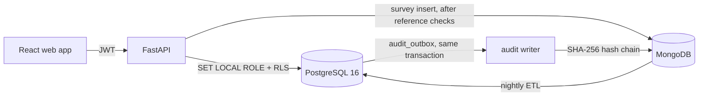

# CO-PO Attainment Management System

DBMS (CD252IA) project, Dept. of ISE, RV College of Engineering — Team 2.

A PostgreSQL + MongoDB system that takes a teacher's CO-PO work off their hands. It computes Course
Outcome (CO) and Program Outcome (PO) attainment from question-wise marks and course-exit surveys,
finds why a CO is weak, simulates rule changes, and keeps a tamper-evident audit trail. The rules
live in the database, not in code. It is built to save teachers time, not to produce NBA/NAAC
accreditation reports.

Three features go beyond automation: **answer-sheet OCR**, **early-warning prediction** and
**prerequisite-aware root-cause analysis**, all built.

**Status:** all ten phases are built and 205 tests pass. Google Forms surveys need
a one-time Google Cloud setup (Google Forms surveys, below).
What's left is tracked in [implementation.md](implementation.md#pending).

- Requirements: [PRD](https://claude.ai/artifact/G8HdvxVTjQ47XZ6AeEhard)
- Build plan and progress: [implementation.md](implementation.md)
- Schema: [docs/er-diagram.md](docs/er-diagram.md)
- Test results: [docs/test-report.md](docs/test-report.md)

## Features

### Built

- **Marks capture:** CIE tests, quizzes and the SEE are read from the scanned answer sheets (below);
  experiential learning (EL) is one final mark per student: on the Marks tab the teacher adds EL by
  typing its maximum (e.g. 40), then types each student's mark. EL counts only in the final total,
  not in CO attainment. Either way
  the whole batch is validated and nothing is saved if any row fails. Absent students are marked
  `AB` and score 0. There is no CSV upload.
- **Locking:** an assessment locks only when every mark is in. Unlocking needs a request approved by
  the HoD, and every rejected edit to locked marks is logged.
- **Attainment engine:** one stored procedure computes direct, indirect and final CO levels and the
  PO values for an offering. It refuses to run while any assessment is unlocked.
- **Versioned rules:** targets, level thresholds and weights are rows with a validity period. Each
  offering uses the rules in force for its term, so old results stay reproducible.
- **Improvement actions:** COs below target get an action automatically. Recomputing links follow-ups
  to earlier actions.
- **Root cause:** for a weak CO, the system walks the CO-dependency graph up to three levels back
  (configurable, with each extra level weighted less) and ranks upstream COs by path strength ×
  correlation over the same students. The output is
  correlational evidence, not proof.
- **What-if simulator:** re-run an offering with different targets or weights. The results go to
  scenario tables only and never touch official results.
- **Surveys:** course-exit surveys are stored in MongoDB, checked against PostgreSQL on insert, and
  turned into indirect attainment by a nightly ETL job.
- **Audit chain:** every change goes to an outbox in the same transaction, then into a SHA-256
  hash-chained MongoDB log with a daily anchor and a verifier.
- **Access control:** PostgreSQL row-level security per role (HoD, faculty, coordinator, student).
  Faculty see only their own offerings and students only their own rows.
- **Answer-sheet OCR (novelty):** scan one PDF per sitting: on the Marks tab, pick CIE 1, CIE 2,
  CIE 3 or SEE and choose "Scan answer sheets". Page 1 is the question paper. A CIE paper holds both parts,
  the quiz under "Part A - Quiz" and the test under "Part B - Test", numbered on across parts
  (Q1-Q5, then Q6-Q11); an SEE paper is one list. Tesseract reads each question's number, max
  marks, COs, Bloom level and part (a Bloom field garbled inside its line is read again on its
  own). Every later page is a student's cover page with one mark row
  per paper question (Q1-Q20): the corner squares straighten the scan and a digit model trained on
  MNIST reads the USN and the handwritten marks. CIE n (1-3) fills `Quiz n` with Part A and
  `CIE Test n` with Part B, both stored as CIE n; the SEE fills `SEE`. An assessment the offering does not have yet is created from the
  paper, and inside each assessment the questions are numbered from Q1 in paper order (paper Q6, the
  first test question, is `CIE Test 1` Q1). Each mark is chosen from 0 to its question's maximum
  and each USN among the enrolled students, so most misreads cannot happen; anything unsure, a
  total that does not add up, or a duplicate USN is highlighted. Nothing is saved until the teacher
  ticks that they checked the highlighted values; then both parts' questions and marks are saved in
  one transaction, through the same validation as typed marks. Locking and computing stay separate
  steps. Each mark comes from its own question's row, an unreadable page can be typed in or
  skipped, and a student with no sheet in this PDF is saved as absent only if they have no marks yet
  (one class can be scanned in several PDFs). The highlight threshold is the rule version's
  `ocr_review_confidence` (default 0.90). Everything runs locally and the scans are not stored. The
  cover-page layout is a synthetic stand-in with 20 mark rows (`api/ocr/layout.py`).
- **Google Forms surveys:** an offering's **Survey** tab creates the course-exit survey as a Google
  Form in the teacher's own Google account (college email, USN, name, phone, then one 1–5 rating per
  CO) and shares it with **Share on WhatsApp**, which opens WhatsApp with the link and a message
  filled in. **Fetch responses** (and a nightly job) checks each response like an in-app survey and
  keeps only a hashed USN and the ratings. The tab shows the response rate and the ratings per CO.
  Needs a one-time Google Cloud setup (see Google Forms surveys below).
- **Weak-student lists:** an offering's **Students** tab lists, per CO, the students whose CO score
  is below target (from the marks so far during the term), with **Copy USNs** for remedial classes.
- **Final marks:** the **Students** tab shows each student's CIE 1-3 percentages, which CIE was
  dropped (each student keeps their best two), EL, SEE and the total out of 100, partial while the
  term runs. The course-file PDF includes the same table.
- **Root cause per student:** the **Students** tab also lists every student below target in one or
  more COs: the COs they missed (their score against the target), the questions where they lost the
  most marks (question, assessment, marks lost, CO), and whether they were also weak in the related
  CO of a prerequisite course (the CO-dependency links root-cause analysis walks, with their score
  there).
- **Early warning (novelty):** when a CIE test or quiz is locked, a logistic regression trained on
  earlier offerings of the same course, at the same point of the term, gives each student's chance
  of ending below target in each CO. Features: the CO marks so far and the student's scores on the
  prerequisite COs (the root-cause links). Students at or above the rule version's `ew_flag_prob`
  (default 0.5) are flagged with the reason, e.g. "CO2 marks so far 23% (typical 70%)". It is
  advice only and never changes official results. Replayed on 2025-26: AUC 0.79 after CIE Test 1
  ([docs/early-warning-evaluation.md](docs/early-warning-evaluation.md)).
- **Course file (PDF):** **Course file (PDF)** on a computed offering downloads its course-file
  report: rules used, assessments, CO attainment with a chart, the course-exit survey, PO attainment
  with a chart, COs below target with how many students are below target and the likely upstream
  causes, the improvement actions, and each student's final marks. Every figure comes from the database. Text is set in FiraGO
  (open licence, embedded), so symbols, curly quotes and Indian scripts in CO statements print as typed.
- **Web app:** offerings overview with a year and semester picker (every subject of a semester
  together, defaulting to a semester with current-year offerings), marks and locking, attainment
  ladder and CO-PO matrix, root cause, students (early warning, weak students, final marks), survey,
  audit, and a student view. To keep it simple, the What-if tab, the Trends and Improvement actions
  pages and the rule-versions section are hidden from the screens; their code, routes and API stay. Screens animate in with
  Motion and GSAP (the CO ladder, matrix and charts draw in), the sign-in page shows an animated
  CO-PO network, signed-out visitors land on a product page at `/` written for teachers (no technical terms; the picture tilts, cards light up and buttons lean toward the cursor, on mouse and trackpad only), and every animation respects the reduced-motion setting.

## How attainment is calculated

1. **Student CO score.** A term has three CIEs; CIE n is Quiz n and CIE Test n, written in one
   sitting. For each student, rank their CIEs by percentage ((quiz n + test n marks) / (quiz n +
   test n maximum), AB = 0) and keep the best two (ties go to the earlier CIE; a student with two or
   fewer CIEs keeps them all). Marks of the dropped CIE are left out of that student's CO scores.
   Then, for each assessment component, take the student's marks on the questions that test the CO,
   divided by the maximum for those questions, and combine the components with these weights, using
   only the components that test the CO:

   | Component | CIE test | CIE quiz | SEE |
   | --- | ---: | ---: | ---: |
   | Weight | 30 | 20 | 50 |

   Experiential learning (EL) is one final mark per student and is not part of CO attainment.
2. **Direct level.** Take the share of students whose CO score reaches the target (60 %), and map it
   to a level: 3 if ≥ 70 % of students, 2 if ≥ 60 %, 1 if ≥ 50 %, otherwise 0.
3. **Indirect level.** Take the share of survey ratings at or above the rule version's
   `favourable_rating` (4) for the CO and map it through the same thresholds. It is 0 if there is
   no survey.
4. **Final CO level** = (80 × direct + 20 × indirect) / 100.
5. **PO per offering** = Σ(strength × final CO level) / Σ strength over the CO-PO map.
   **Programme PO** is the plain average of the offering values.

All the numbers above come from the current rule version in `attainment_config`. The demo data has
two versions: target 55 % until Aug 2024, then 60 %.

**Final marks.** Each student's total out of 100 = (average % of their best two CIEs) × 30 + (EL mark
/ EL maximum) × 20 + (SEE / SEE maximum) × 50. While the term runs, the total counts only the parts
with marks and says what it is out of. The best-of count and the 30 / 20 / 50 split are rules in
`attainment_config` too (`cie_best_of`, `total_*_weight`).

## Architecture



Each request runs in one transaction as the caller's database role. Business rules are enforced by
triggers, CHECK constraints and the stored procedure, so the API cannot bypass them.

## Tech stack

| Layer | Choice |
| --- | --- |
| Relational DB | PostgreSQL 16: PL/pgSQL triggers, RLS, materialized views, recursive CTEs, `corr()` |
| Document DB | MongoDB 8: survey responses, hash-chained audit log |
| Backend | Python 3.11, FastAPI, psycopg 3, pymongo, bcrypt, PyJWT, APScheduler |
| Frontend | React 18 + TypeScript (Vite), taste-skill `charts.js` |
| Test data | Faker + NumPy generator with a fixed seed |
| Tests | pytest against a dedicated `copo_test` database |

## Repository layout

```
db/migrations/   001_schema … 012_early_warning: tables, triggers, views, procedures, indexes, RLS
db/seed/         worked_example.sql (PRD Section 5)
datagen/         synthetic programme, marks and surveys; planted root-cause scenario
api/             FastAPI app: routers/, services/ (marks, surveys, what-if), jobs/ (ETL, audit)
web/             React + TypeScript app (Vite)
scripts/         setup_db, migrate, demo, explain_report, evaluate_root_cause
tests/           pytest suites, one per PRD test
docs/            ER diagram, index report, root-cause evaluation, test report
```

## Quick start

Prerequisites: PostgreSQL 16 (`winget install PostgreSQL.PostgreSQL.16`), MongoDB 8 on
`localhost:27017`, Python 3.11+ and Node 20+. Answer-sheet OCR also needs Tesseract 5
(`winget install UB-Mannheim.TesseractOCR`); set `TESSERACT_CMD` in `.env` if it is not in the
default folder.

```powershell
python -m venv .venv
.\.venv\Scripts\python.exe -m pip install -r requirements.txt
copy .env.example .env                               # fill in passwords, JWT_SECRET, DEMO_PASSWORD

.\.venv\Scripts\python.exe -m scripts.setup_db       # roles + database (uses the superuser password)
.\.venv\Scripts\python.exe -m scripts.demo           # schema, data, ETL, compute, audit chain (a few minutes)
.\.venv\Scripts\python.exe -m scripts.train_digits   # once: handwritten-digit model for answer-sheet OCR (about 4 min)

cd web; npm install; npm run build; cd ..
.\.venv\Scripts\uvicorn.exe api.main:app --port 8000
```

Open http://localhost:8000 and sign in with `DEMO_PASSWORD` from `.env`:

| Login | Role | Sees |
| --- | --- | --- |
| `hod` | HoD (`admin`) | Every offering, unlock approvals, rule versions, audit verification |
| `fac01` – `fac14` | Faculty | Own offerings only: scan answer sheets, type EL marks, lock, compute, root cause, final marks |
| `coordinator` | Programme coordinator | Everything, read-only, plus audit verification |
| `1rv23is001` (and other USNs) | Student | Own CO scores and course-exit surveys |

API docs are at http://localhost:8000/docs. For UI development, run `npm run dev` in `web/` (Vite
on :5173, with `/api` proxied to :8000).

## Step by step

### Database

```powershell
.\.venv\Scripts\python.exe -m scripts.migrate              # apply db/migrations in order
.\.venv\Scripts\python.exe -m scripts.migrate --reset      # drop and recreate the schema
.\.venv\Scripts\python.exe -m scripts.migrate --until 005  # stop after a given migration
```

### Synthetic data

```powershell
.\.venv\Scripts\python.exe -m datagen.generate --reset
```

The generator builds one ISE programme:

- 16 courses and 6 batches, giving 1,440 students.
- 280 offerings from 2021-22 to 2026-27 (odd term). Every finished offering has CIE 1-3 (Quiz n +
  CIE Test n), a single-mark EL out of 40 and the SEE, all locked and computed.
- 681,120 question-wise marks and 11,933 course-exit surveys.
- Current-term (2026-27 odd) offerings are part-way through, by section: A has nothing yet (scan it
  from CIE 1), B has CIE 1 locked and CIE 2 saved, C has CIE 1 and 2 locked, D has CIE 1 saved.

Demo logins (`hod`, `coordinator`, `fac01`–`fac14`, four student USNs) use `DEMO_PASSWORD` from
`.env`. `scripts.demo` gives student `DEMO_STUDENT_USN` (default 1RV23IS010) the college email in
`DEMO_STUDENT_EMAIL`, if set, so a real Google account can answer that student's survey. Survey
respondents are stored as an HMAC of the USN keyed by `SURVEY_HASH_SECRET`, so set it and
`DEMO_PASSWORD` before generating. `--reset` empties PostgreSQL and the MongoDB `survey_responses` and
`audit_log` together; the PostgreSQL load commits only once the surveys are in MongoDB.
`--database NAME` targets the PostgreSQL and MongoDB databases of that name.

The 2023 batch carries a planted root-cause story: Data Structures CO2 → DBMS CO4, with Programming
in C CO5 as a decoy (`datagen/catalog.py`). All data, including course titles, CO statements and
CO-PO mappings, is synthetic.

For answer-sheet OCR, `python -m datagen.ocr_samples --offering-id N --sitting CIE1` (or `CIE2`,
`CIE3`, `SEE`) writes a scanned-looking PDF for that sitting to `samples/`: a printed question paper (for a
CIE, Part A - Quiz and Part B - Test, numbered on across parts; the offering's saved questions, or
a typical paper if the quiz or test does not exist yet), then one cover page per enrolled student
with the marks of both parts written in MNIST digits the model never trained on, slightly rotated
and noised. A JSON answer key with every true value is written next to it.

### Computing attainment

```sql
CALL sp_compute_attainment(42);   -- one offering (all its assessments must be locked)
CALL sp_compute_all();            -- every offering whose assessments are all locked
```

Results land in `co_attainment` / `po_attainment` with the offering's own rule version (another
`config_id` is refused with CP015; try other rules as a what-if scenario). COs below target get an
automatic `improvement_action`; a recompute updates its text, or closes it once the CO meets the
target. Errors use SQLSTATE class `CP` (listed at the top of each migration).

Who may run what: `sp_compute_attainment` is granted to `copo_admin` and `copo_faculty` (faculty
only for offerings they teach), `sp_compute_all` and `fn_refresh_dashboards` to `copo_admin`. The
role comes from `app.role`, which is trusted only alongside the matching `SET ROLE copo_<role>`;
owner and superuser logins (migrations, jobs, tests) set neither.

While a compute runs, the offering's assessments cannot be locked or unlocked, and dashboard reads
continue (views refresh `CONCURRENTLY`). Students cannot be enrolled into an offering with a locked
assessment.

### Root cause and what-if

```sql
SELECT * FROM fn_root_cause(42, 196);            -- ranked upstream COs for a weak CO
SELECT fn_root_cause_action(42, 196);            -- pre-fill an improvement action from the top cause
CALL sp_compute_attainment(42, NULL, false, 7);  -- run what-if scenario 7 (official tables untouched)
```

- **Root cause** walks `co_dependency` upstream and scores each upstream CO by path strength ×
  Pearson r of the same students' scores. Path strength is the product of strength/3, times
  `rc_depth_decay` (default 0.8) for each level beyond the first, up to `rc_max_depth` (default 3).
  A candidate passes with n ≥ `rc_min_n` and a defined r ≥ `rc_min_r`. All of these, the target and
  the scoring weights come from the rule version of the offering's official results. Each upstream
  CO's shortfall is against its own target (blank if it has no result). Errors: `CP010` offering,
  `CP011` rule version, `22023` CO not of the course.
- **Actions from root cause** are refused for a CO at target or not yet computed (`CP016`); asking
  twice returns the same open action.
- **What-if** scenarios start from the rule version of the official results (or the term's version
  before the first compute; `base_config_id` picks another). Unknown fields and out-of-range values
  are refused, a weight given alone gets its complement, and thresholds must stay l3 ≥ l2 ≥ l1.
  Re-running an older rule version is a what-if; official results always use the term's version
  (`CP015`).

`python -m scripts.evaluate_root_cause [--database copo_test] [--dataset copo]` rebuilds the
scenario in the scratch database (migrated and emptied first) and writes detection,
false-positive and noise-sensitivity results to `docs/root-cause-evaluation.md`.

### Background jobs

```powershell
.\.venv\Scripts\python.exe -m api.jobs forms      # Google Form responses -> survey_responses (checked, anonymised)
.\.venv\Scripts\python.exe -m api.jobs etl        # surveys (MongoDB) -> indirect_attainment, then recompute
.\.venv\Scripts\python.exe -m api.jobs audit      # audit_outbox -> hash-chained MongoDB audit_log
.\.venv\Scripts\python.exe -m api.jobs anchor     # copy the chain head into audit_anchor
.\.venv\Scripts\python.exe -m api.jobs verify     # recompute the chain; reports the first broken seq
.\.venv\Scripts\python.exe -m api.jobs schedule   # all of the above on their schedules
```

- **Surveys.** A response is accepted once the offering is finished (all assessments locked), from an
  enrolled student, and must rate every CO of the course 1–5. Respondents are stored as a keyed hash
  (`SURVEY_HASH_SECRET`). The ETL stores respondents and % favourable per (offering, CO), using the
  rule version's `favourable_rating` (default 4); the engine turns that % into a level with the
  thresholds of each run. Groups without responses are removed, and offerings with official results
  whose survey input changed are recomputed; one that cannot be (an assessment unlocked again) is
  reported and keeps its results.
- **Audit chain.** Audited changes (marks, maps, rules, results, survey input, logins, enrolments,
  workflow, and `TRUNCATE`) are written to `audit_outbox` in the same transaction as the change, so
  the MongoDB chain can lag but never miss a change. Password hashes are never copied. Only the API
  login's `app.user` names the person; other sessions are recorded under their login.
- **Chain and PostgreSQL agree.** The writer records each event's place in the chain in the outbox
  before writing MongoDB, so after a crash it knows what reached MongoDB, and `verify` treats the last
  recorded event as an anchor: deleting the newest documents is reported, and the writer stops
  (`ChainError`) rather than writing over the gap. A PostgreSQL reset does not break the chain; it
  carries on from its head.
- **Schedule.** Outbox every 30 s, Google Forms fetch 01:15, ETL 01:30, verify 02:00, anchor 23:55 (Asia/Kolkata). A run
  missed while the machine was off happens once when it is back.

### Google Forms surveys (setup, once)

Course-exit surveys are created as Google Forms in each teacher's own Google account. The server
needs one free Google Cloud project (no billing account is needed):

1. Open https://console.cloud.google.com, create a project (e.g. `copo-surveys`).
2. **APIs & Services → Library**: enable the **Google Forms API**.
3. **APIs & Services → OAuth consent screen** (Google Auth Platform → Branding/Audience/Data access):
   app name and support email; audience **External**, publishing status **Testing**; add the scopes
   `.../auth/forms.body`, `.../auth/forms.responses.readonly`, `.../auth/drive.file` (only to
   delete a form this app made if creating it fails), `openid` and `email`; under **Test
   users** add the Google account of every teacher who will create forms.
4. **APIs & Services → Credentials → Create credentials → OAuth client ID**: type **Web
   application**, authorised redirect URI `http://localhost:8000/api/google/callback`.
5. Put the client ID and secret in `.env` as `GOOGLE_CLIENT_ID` and `GOOGLE_CLIENT_SECRET`, and a
   token key as `GOOGLE_TOKEN_KEY` (`python -c "from cryptography.fernet import Fernet;
   print(Fernet.generate_key().decode())"`). Restart the API.

Then a teacher opens an offering's **Survey** tab, clicks **Connect Google** once, and **Create the
survey form**. Students sign in with their Google account to answer: the form records their
verified email (Google's "verified" email collection; it cannot be typed), then asks for USN, name
and phone number and one 1–5 rating per CO. **Share on WhatsApp** opens WhatsApp with the link and a
message filled in. **Fetch responses** (and the nightly `forms` job at 01:15) reads the responses:
the verified email must be of `COLLEGE_EMAIL_DOMAIN` (default `rvce.edu.in`) and be the email on
record for the USN given (`student.email`), so nobody can answer as a classmate; the USN must be
enrolled, every CO rated, and the response the student's first. It is then stored like an in-app
survey, with a hashed USN only. Email, name and phone number are not stored. Refresh tokens are
stored encrypted and only their owner can use them; the Google sign-in only completes in the
browser that started it.

### Error codes

Rule violations raise SQLSTATE class `CP`. The API returns them with the database's own message.

| Code | Meaning | Code | Meaning |
| --- | --- | --- | --- |
| CP001 | Assessment is locked | CP007 | Unlock not approved |
| CP002 | Marks out of range | CP010 | Offering not found |
| CP003 | Reference outside its offering, course or programme | CP011 | No rule version for the term |
| CP004 | Weights do not sum to 1 (question) or 100 (components) | CP012 | Assessments missing or unlocked |
| CP005 | Cycle, or CO outside the prerequisite graph | CP013 | CO not assessed |
| CP006 | Marks incomplete at lock | CP014 | Invalid scenario |
| | | CP015 | Config is not the offering's rule version (use a what-if) |
| | | CP016 | Root-cause action for a CO without a shortfall |
| | | CP017 | An EL question tagged to a CO (EL is one final mark) |

## Tests

```powershell
.\.venv\Scripts\python.exe -m scripts.setup_db --database copo_test   # once
.\.venv\Scripts\python.exe -m pytest
```

All 206 tests pass in a few minutes (the OCR tests need Tesseract and the digit model, and are
skipped without them). Each test rebuilds `copo_test` and re-seeds the worked example.
They cover:

- **Correctness:** the worked example gives CO 3.00 / 2.20 / 0.40, PO1 2.30 and PO2 1.48.
- **Constraints, access control and audit tamper detection.**
- **Root cause, simulator isolation, concurrency and reproducibility.**

The results are mapped to the PRD tests in [docs/test-report.md](docs/test-report.md).

| Report | Command |
| --- | --- |
| [docs/explain/report.md](docs/explain/report.md): index EXPLAIN ANALYZE | `python -m scripts.explain_report` |
| [docs/root-cause-evaluation.md](docs/root-cause-evaluation.md): detection and false positives | `python -m scripts.evaluate_root_cause` |
| [docs/ocr-evaluation.md](docs/ocr-evaluation.md): answer-sheet OCR accuracy on synthetic scans | `python -m scripts.evaluate_ocr` |
| [docs/early-warning-evaluation.md](docs/early-warning-evaluation.md): early warning replayed on 2025-26 | `python -m scripts.evaluate_early_warning` |

## Contributing

See [CLAUDE.md](CLAUDE.md) for the git workflow:

- Use one branch per feature.
- Commit small and often, with Conventional Commits.
- Changes land on `main` through PRs.
- Never commit `.env` or real student data.

## License

[MIT](LICENSE)
