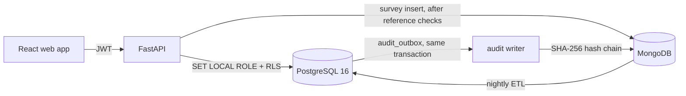

# CO-PO Attainment Management System

DBMS (CD252IA) project, Dept. of ISE, RV College of Engineering — Team 2.

A PostgreSQL + MongoDB system that computes Course Outcome (CO) and Program Outcome (PO) attainment
from question-wise marks and course-exit surveys. It finds why a CO is weak, simulates rule changes,
and keeps a tamper-evident audit trail. The rules live in the database, not in code.

**Status:** all six build phases are done and 84 tests pass. What's left is tracked in
[implementation.md](implementation.md#pending).

- Requirements: [PRD](https://claude.ai/artifact/G8HdvxVTjQ47XZ6AeEhard)
- Build plan and progress: [implementation.md](implementation.md)
- Schema: [docs/er-diagram.md](docs/er-diagram.md)
- Test results: [docs/test-report.md](docs/test-report.md)

## Features

- **Marks capture:** question-wise CSV upload, with every row validated and nothing saved if any row
  fails. Absent students are marked `AB` and score 0.
- **Locking:** an assessment locks only when every mark is in. Unlocking needs a request approved by
  the HoD, and every rejected edit to locked marks is logged.
- **Attainment engine:** one stored procedure computes direct, indirect and final CO levels and the
  PO values for an offering. It refuses to run while any assessment is unlocked.
- **Versioned rules:** targets, level thresholds and weights are rows with a validity period. Each
  offering uses the rules in force for its term, so old results stay reproducible.
- **Improvement actions:** COs below target get an action automatically. Recomputing links follow-ups
  to earlier actions.
- **Root cause:** for a weak CO, the system walks the CO-dependency graph up to three levels back and
  ranks upstream COs by path strength × correlation over the same students. The output is
  correlational evidence, not proof.
- **What-if simulator:** re-run an offering with different targets or weights. The results go to
  scenario tables only and never touch official results.
- **Surveys:** course-exit surveys are stored in MongoDB, checked against PostgreSQL on insert, and
  turned into indirect attainment by a nightly ETL job.
- **Audit chain:** every change goes to an outbox in the same transaction, then into a SHA-256
  hash-chained MongoDB log with a daily anchor and a verifier.
- **Access control:** PostgreSQL row-level security per role (HoD, faculty, coordinator, student).
  Faculty see only their own offerings and students only their own rows.
- **Web app:** offerings overview, marks and locking, attainment ladder and CO-PO matrix, root cause,
  what-if, trends, improvement actions, rules and audit, and a student view.

## How attainment is calculated

1. **Student CO score.** For each assessment component, take the student's marks on the questions
   that test the CO, divided by the maximum for those questions. Combine the components with these
   weights, using only the components that test the CO:

   | Component | CIE theory | CIE quiz | EL | SEE |
   | --- | ---: | ---: | ---: | ---: |
   | Weight | 20 | 10 | 20 | 50 |

   (CIE theory 40 + quiz 20 + EL 40 + SEE 100, halved, gives 100.)
2. **Direct level.** Take the share of students whose CO score reaches the target (60 %), and map it
   to a level: 3 if ≥ 70 % of students, 2 if ≥ 60 %, 1 if ≥ 50 %, otherwise 0.
3. **Indirect level.** Take the share of survey ratings ≥ 4 for the CO and map it through the same
   thresholds. It is 0 if there is no survey.
4. **Final CO level** = (80 × direct + 20 × indirect) / 100.
5. **PO per offering** = Σ(strength × final CO level) / Σ strength over the CO-PO map.
   **Programme PO** is the plain average of the offering values.

All the numbers above come from the current rule version in `attainment_config`. The demo data has
two versions: target 55 % until Aug 2024, then 60 %.

## Architecture



Each request runs in one transaction as the caller's database role. Business rules are enforced by
triggers, CHECK constraints and the stored procedure, so the API cannot bypass them.

## Tech stack

| Layer | Choice |
| --- | --- |
| Relational DB | PostgreSQL 16: PL/pgSQL triggers, RLS, materialized views, recursive CTEs, `corr()` |
| Document DB | MongoDB 8: survey responses, hash-chained audit log |
| Backend | Python 3.11, FastAPI, psycopg 3, pymongo, bcrypt, PyJWT, APScheduler |
| Frontend | React 18 + TypeScript (Vite), taste-skill `charts.js` |
| Test data | Faker + NumPy generator with a fixed seed |
| Tests | pytest against a dedicated `copo_test` database |

## Repository layout

```
db/migrations/   001_schema … 009_security: tables, triggers, views, procedures, indexes, RLS
db/seed/         worked_example.sql (PRD Section 5)
datagen/         synthetic programme, marks and surveys; planted root-cause scenario
api/             FastAPI app: routers/, services/ (marks CSV, surveys, what-if), jobs/ (ETL, audit)
web/             React + TypeScript app (Vite)
scripts/         setup_db, migrate, demo, explain_report, evaluate_root_cause
tests/           pytest suites, one per PRD test
docs/            ER diagram, index report, root-cause evaluation, test report
```

## Quick start

Prerequisites: PostgreSQL 16 (`winget install PostgreSQL.PostgreSQL.16`), MongoDB 8 on
`localhost:27017`, Python 3.11+ and Node 20+.

```powershell
python -m venv .venv
.\.venv\Scripts\python.exe -m pip install -r requirements.txt
copy .env.example .env                               # fill in passwords, JWT_SECRET, DEMO_PASSWORD

.\.venv\Scripts\python.exe -m scripts.setup_db       # roles + database (uses the superuser password)
.\.venv\Scripts\python.exe -m scripts.demo           # schema, data, ETL, compute, audit chain (a few minutes)

cd web; npm install; npm run build; cd ..
.\.venv\Scripts\uvicorn.exe api.main:app --port 8000
```

Open http://localhost:8000 and sign in with `DEMO_PASSWORD` from `.env`:

| Login | Role | Sees |
| --- | --- | --- |
| `hod` | HoD (`admin`) | Every offering, unlock approvals, rule versions, audit verification |
| `fac01` – `fac14` | Faculty | Own offerings only: marks upload, lock, compute, root cause, what-if |
| `coordinator` | Coordinator | Everything, read-only, plus audit verification |
| `1rv23is001` (and other USNs) | Student | Own CO scores and course-exit surveys |

API docs are at http://localhost:8000/docs. For UI development, run `npm run dev` in `web/` (Vite
on :5173, with `/api` proxied to :8000).

## Step by step

### Database

```powershell
.\.venv\Scripts\python.exe -m scripts.migrate              # apply db/migrations in order
.\.venv\Scripts\python.exe -m scripts.migrate --reset      # drop and recreate the schema
.\.venv\Scripts\python.exe -m scripts.migrate --until 005  # stop after a given migration
```

### Synthetic data

```powershell
.\.venv\Scripts\python.exe -m datagen.generate --reset
```

The generator builds one ISE programme:

- 16 courses and 6 batches, giving 1,440 students.
- 280 offerings from 2021-22 to 2026-27 (odd term).
- 556,800 question-wise marks and 11,965 course-exit surveys.
- Current-term offerings have only CIE Test 1 and Quiz 1, and stay unlocked.

The 2023 batch carries a planted root-cause story: Data Structures CO2 → DBMS CO4, with Programming
in C CO5 as a decoy (`datagen/catalog.py`). All data, including course titles, CO statements and
CO-PO mappings, is synthetic.

### Computing attainment

```sql
CALL sp_compute_attainment(42);   -- one offering (all its assessments must be locked)
CALL sp_compute_all();            -- every offering whose assessments are all locked
```

Results land in `co_attainment` / `po_attainment` together with the `config_id` used.

### Root cause and what-if

```sql
SELECT * FROM fn_root_cause(42, 196);            -- ranked upstream COs for a weak CO
SELECT fn_root_cause_action(42, 196);            -- pre-fill an improvement action from the top cause
CALL sp_compute_attainment(42, NULL, false, 7);  -- run what-if scenario 7 (official tables untouched)
```

### Background jobs

```powershell
.\.venv\Scripts\python.exe -m api.jobs etl        # surveys (MongoDB) -> indirect_attainment
.\.venv\Scripts\python.exe -m api.jobs audit      # audit_outbox -> hash-chained MongoDB audit_log
.\.venv\Scripts\python.exe -m api.jobs anchor     # copy the chain head into audit_anchor
.\.venv\Scripts\python.exe -m api.jobs verify     # recompute the chain; reports the first broken seq
.\.venv\Scripts\python.exe -m api.jobs schedule   # all of the above on their schedules
```

The MongoDB chain can lag behind PostgreSQL but never misses a change, because the outbox row is
written in the same transaction as the change.

### Error codes

Rule violations raise SQLSTATE class `CP`. The API returns them with the database's own message.

| Code | Meaning | Code | Meaning |
| --- | --- | --- | --- |
| CP001 | Assessment is locked | CP007 | Unlock not approved |
| CP002 | Marks out of range | CP010 | Offering not found |
| CP003 | Reference outside its offering, course or programme | CP011 | No rule version for the term |
| CP004 | Weights do not sum to 1 (question) or 100 (components) | CP012 | Assessments missing or unlocked |
| CP005 | Cycle, or CO outside the prerequisite graph | CP013 | CO not assessed |
| CP006 | Marks incomplete at lock | CP014 | Invalid scenario |

## Tests

```powershell
.\.venv\Scripts\python.exe -m scripts.setup_db --database copo_test   # once
.\.venv\Scripts\python.exe -m pytest
```

All 84 tests pass in about a minute. Each test rebuilds `copo_test` and re-seeds the worked example.
They cover:

- **Correctness:** the worked example gives CO 3.00 / 2.20 / 0.40, PO1 2.30 and PO2 1.48.
- **Constraints, access control and audit tamper detection.**
- **Root cause, simulator isolation, concurrency and reproducibility.**

The results are mapped to the PRD tests in [docs/test-report.md](docs/test-report.md).

| Report | Command |
| --- | --- |
| [docs/explain/report.md](docs/explain/report.md): index EXPLAIN ANALYZE | `python -m scripts.explain_report` |
| [docs/root-cause-evaluation.md](docs/root-cause-evaluation.md): detection and false positives | `python -m scripts.evaluate_root_cause` |

## Contributing

See [CLAUDE.md](CLAUDE.md) for the git workflow:

- Use one branch per feature.
- Commit small and often, with Conventional Commits.
- Changes land on `main` through PRs.
- Never commit `.env` or real student data.

## License

[MIT](LICENSE)
