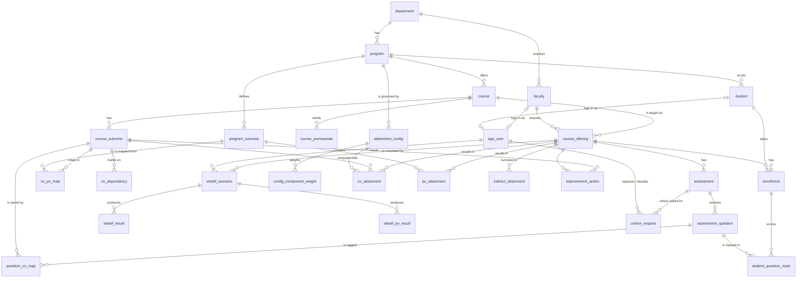

# ER diagram

29 tables: the 25 from the source design plus `config_component_weight`, `whatif_po_result`,
`unlock_request` and `audit_outbox` (PRD Section 9 changes). DDL: `db/migrations/001_schema.sql`.

`audit_outbox` and `audit_anchor` stand alone: the outbox is filled by audit triggers on the audited
tables and records where each row landed in the MongoDB audit chain (`chain_seq`, `chain_hash`), and
the anchor stores the daily head hash of the chain.

## Key rules

| Rule | Where |
| --- | --- |
| CO-PO and dependency strength 1–3 | CHECK on `co_po_map`, `co_dependency` |
| 0 ≤ marks ≤ question maximum | CHECK (≥ 0) here; upper bound in the `mark_guard` trigger (Phase 3, `002_integrity.sql`) |
| Component weights of a config sum to 100 | deferred trigger (Phase 3, `002_integrity.sql`) |
| Absent ⇔ marks NULL; scored as 0 | CHECK on `student_question_mark` |
| direct_weight + indirect_weight = 100 | CHECK on `attainment_config`, `whatif_scenario` |
| l3 ≥ l2 ≥ l1 | CHECK on `attainment_config`, `whatif_scenario` |
| One config per programme per date | EXCLUDE (gist) on `attainment_config`, checked at commit |
| Percentages 0–100, levels 0–3 | domains `pct_0_100`, `level_0_3`, `attainment_0_3` on rule and result tables (official and what-if) |
| One student per offering once | UNIQUE `enrollment (offering_id, usn)` |
| One automatic action per (offering, CO) | partial unique index on `improvement_action` |
| Role needs its link (faculty_id / usn) | CHECKs on `app_user` |
| At most one login per faculty member / student | UNIQUE `app_user (faculty_id)`, `app_user (usn)` |
| Unlock decision has who and when; no self-approval | CHECKs on `unlock_request` |
